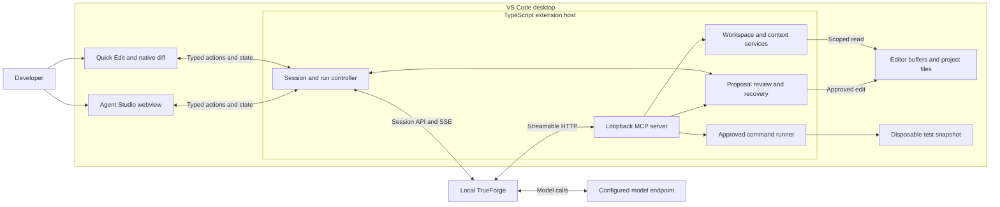

# VANTA architecture

This Round 1 proposal reflects the repository as of 14 November 2026. The repository starts from `e32712c` with a README, MIT license and ignore file. Version and source checks below establish the integration baseline. [REQUIREMENTS.md](REQUIREMENTS.md) maps decisions to judging evidence.

## System boundary

| Owner | Planned interface and responsibility |
| --- | --- |
| Extension entry point | Register a selection-scoped keybinding, Quick Edit input, Agent Studio view, status item and review commands. Dispose network, cancellation and VS Code resources on shutdown. |
| Run controller | Own a workspace-bound run ID, TrueForge session and turn IDs, connection state, active model profile, cancellation signal and cumulative context ledger. Serialize turns and cancellation per session. |
| TrueForge adapter | Create sessions and stream turns, submit explicit approvals, cancel the active turn and reconcile stored events. Translate verified upstream payloads into typed local state. |
| Workspace and context services | Resolve trusted root-relative paths and active buffers, query symbols and text, rank and budget snippets, and explain each selection. Expose the same services to UI context selection and MCP tools. |
| Proposal store and review service | Store immutable base snapshots, staged revisions, hunk decisions and approval receipts. Render real editor diffs and apply or undo approved changes through an editor adapter. |
| MCP bridge and command runner | Validate authenticated transport and tool inputs. Enforce run scope, capability policy, cancellation and output caps. Execute approved, structured commands in a disposable source snapshot. |
| Agent Studio | Display transcript, live timeline, Context Explorer, proposals, review controls, diagnostics, tests, history, and model and connection status. Render host snapshots and incremental updates. |

Build the Studio as a bundled React `WebviewView` with a single host-owned state model. React earns its weight here through reusable, testable components for independently changing panels. Use VS Code theme tokens, semantic controls, keyboard navigation, reduced motion and aggregated live announcements. Standard editor commands serve Quick Edit and review in both modes. Validate UI messages and IDs in the host. Use a nonce-based CSP, narrow local resource roots and escaped, sanitized model text with command links disabled. Batch token updates for painting and rehydrate a view from a host snapshot after it reloads. Keep connection details and credentials in the host. [Webview guide](https://code.visualstudio.com/api/extension-guides/webview), [VS Code API](https://code.visualstudio.com/api/references/vscode-api).

## TrueForge contracts

The source at tag `v0.185.1` (`60e4b8c8286c248749182d8b75f0b7cd150985c5`) declares `@truefoundry/trueforge-sdk` version `0.185.0`, which the package registry also reported. Local `GET /healthz` returned `status: ok`, `version: 0.185.1`. Use this pair for the first contract run and recheck the official local `@latest` setup during rehearsal. The health check established server reachability and version. The working Gemini agent turn is reported in the project brief. [Pinned source](https://github.com/truefoundry/trueforge/tree/v0.185.1), [Quickstart](https://trueforge.dev/quickstart).

| Surface | Source-backed contract and planned use |
| --- | --- |
| Sessions and streaming | `new TrueForge({ baseUrl, timeoutInSeconds })`, `sessions.create({ agent })`, and `sessions.createTurnStream(sessionId, { input }, requestOptions?)`. The turn input uses `user.message`. Consume `stream.withMetadata()` and use `turn.created`, `model.message`, `model.message.delta`, `tool.approval_required`, `tool.response`, `turn.update` and `turn.done`. SDK request options carry `abortSignal` and `maxRetries`. |
| Approval | `sessions.createTurnEvents(sessionId, turnId, { events })` sends `user.tool_approval` with `threadId`, `toolCallId` and an allow or deny decision. Resolve `toolCalls[].sourceEventId` to the originating model event to inspect the full call. Reconcile using a subscription before resubmitting any ambiguous decision. |
| Reconnect and cancel | `sessions.subscribeToTurn(sessionId, turnId, request?, options?)` supports `fromEventId` and `afterEventId`. The SDK marks `afterSequenceNumber` deprecated and rejected on new turns. Track transport progress separately from logical event IDs, merge deltas into their base event, and replace partial text when rebuilding an event from its inclusive cursor. `sessions.getTurn` helps reconcile state. `sessions.cancel(sessionId)` targets the active turn in the session. The host stops local work first and reconciles remote completion separately. |
| MCP and model configuration | `settings.mcpServers.create({ manifest })` supports a remote URL and optional header authentication. The agent spec references the configured connector by name. Wire fields `mcp_servers`, `preload`, `preload_tools` and `require_approval_for_tools` are SDK camelCase where applicable. Use literal gated tool names and configured TrueForge model names, with sandbox off. |

The M2 contract spike must exercise SSE framing and delta replay, terminal error shapes, paused-turn approval, denial, cancel during in-flight and paused turns, and post-cancel subscription on this Windows host. M2 and M3 must exercise connector registration, loopback reachability, header delivery, discovery and tool gating with deferred loading. Test whether native gate events resolve the underlying deferred call arguments. Keep the checkpoint and command tools eager if that path is unreliable. [Pinned SDK client](https://github.com/truefoundry/trueforge/blob/v0.185.1/packages/trueforge-sdk/src/api/resources/sessions/client/Client.ts), [pinned agent schema](https://github.com/truefoundry/trueforge/blob/v0.185.1/packages/trueforge-core/src/agent-session/schemas/agentSpec.ts), [pinned TrueForge UI approval adapter](https://github.com/truefoundry/trueforge/blob/v0.185.1/packages/trueforge-ui/src/plugins/trueforge-agent-server-adapter/chatServer.ts), [SDK quickstart](https://trueforge.dev/api/quickstart).

## Agent request lifecycle

1. Quick Edit captures the selected range, text and document version before showing the prompt. Agent Studio captures a root, task, model profile and optional mentions. A new Agent Studio request with no mentions can start without active-editor context for a blind discovery demonstration.
2. Check trust, endpoint health, workspace ownership and model settings. Resolve explicit inputs and collect bounded, high-signal context. Submit one user turn through TrueForge. Quick Edit permits proposals only inside the captured selection, with related reads if needed. Agent Studio enables workspace search, staged multi-file proposals and the gated command capability.
3. TrueForge manages generation and the tool loop. The extension renders actual deltas, tool activity and context-selection records. Refreshing the view leaves the run in the host. Store scoped session IDs and light metadata locally, and fetch history on demand. Avoid duplicating raw prompts and source snippets in UI state persisted on disk.
4. TrueForge approval pauses lead to native review or a command decision. Resolve calls to immutable inputs and send per-call decisions. The model receives the bridge result and decides its next action. It can stage follow-up proposals and request a new review when the exact revision changes.
5. On successful terminal completion, validate and apply the exact user-approved hunks. Show applied, rejected, stale or failed states and diagnostics. Error and cancellation invalidate outstanding authorization and proposals for that attempt. A lost stream shows disconnected state and triggers bounded reconciliation with the same turn.

## MCP tool execution and approval

Bind Streamable HTTP to `127.0.0.1` on an ephemeral port in the extension host. Initially give each request attempt a fresh session and connector with a unique name and generated bearer secret. Register it in local TrueForge and attach the named connector to the agent spec before creating the session. Each connector is scoped to one attempt and one root. History remains viewable by ID after cleanup. A follow-up can open a new session with a short user-visible summary. Reuse of live sessions depends on demonstrating that late calls from a previous turn cannot inherit the next turn's authority. Close listeners, revoke grants and clean up owned connector records on disposal, expiry or startup after a crash. Validate origin if supplied, host and bearer before dispatch. Avoid logging connection headers. Include a manual connector configuration procedure if dynamic registration fails, subject to the same authentication and run-isolation tests. [MCP connector setup](https://trueforge.dev/mcp-servers), [MCP transport and security](https://modelcontextprotocol.io/specification/2025-06-18/basic/transports), [pinned HTTP client](https://github.com/truefoundry/trueforge/blob/v0.185.1/packages/trueforge-core/src/core/mcp/remoteMcpClient.ts).

| Proposed VANTA MCP tool | Boundary |
| --- | --- |
| `search_workspace`, `find_symbol` | Return capped ranked locations and the signals that selected them. Resolve relative paths within the bound root. |
| `read_file` | Return approved range and revision from the staged view, live buffer or disk, in that order. Omit sensitive paths and cap lines and bytes. |
| `propose_edit` | Take bounded anchored replacements or explicit new text files with expected revisions. Validate against the staged view and record an immutable proposal revision. The run's staging area is private to that run. |
| `review_proposal` | Take a host-issued proposal ID and revision. Require native TrueForge approval. The handler returns a receipt for exact reviewed hunks only if a live host approval exists. |
| `run_command` | Take an operation profile ID and validated arguments. Require native TrueForge approval and a one-time host grant for exact normalized arguments, root and snapshot revision. Return capped exit status and redacted output. |

For a review pause, the host reads the referenced `review_proposal` call, freezes the cumulative stage revision, and opens the per-hunk diff. The user selects accept or reject for each hunk. The host records the reviewed IDs and content hashes, then sends allow if any hunks were accepted or deny if the whole proposal was rejected. For an allowed call, `review_proposal` returns a receipt and bounded summary of the resulting overlay. For a denied call, the host discards the rejected proposal during reconciliation so later reads see the prior approved state. New changes to the overlay require review of the resulting revision. Pending approvals expire on cancel, proposal revision change or trust loss. Approving in the TrueForge UI alone cannot mint a local grant. Bind receipts to the authenticated run, call arguments and proposal revision. Confirm at most one matching grant can be active when the MCP transport lacks call identity, and consume it atomically to prevent replay. Workspace apply is a separate host operation that requires the actual gated tool receipt and successful terminal reconciliation. If the user has accepted part of the plan and the run fails, the workspace still holds the original state.

Preload essential read/search/stage and gated checkpoint tools. Defer a small set of follow-up tools, initially symbol lookup and optionally diagnostics, so Task B can demonstrate real discovery of a relevant tool with `list_tools`, `get_tool_info` or `call_tool` in the TrueForge trace. Compare actual traces and token estimates with eager config to substantiate the write-up. Keep read outputs bounded and disable sandbox-dependent features. Select capabilities by literal tool names. [Deferred tool loading](https://trueforge.dev/key-features/deferred-tool-loading), [pinned selector and approval schema](https://github.com/truefoundry/trueforge/blob/v0.185.1/packages/trueforge-core/src/agent-session/schemas/agentSpec.ts).

## Context selection

1. Resolve `@file` to a normalized workspace URI and `@symbol` to provider results when available. Ask the user to disambiguate duplicate names. Anchor Quick Edit to its selection. Read unsaved text through the editor, with versioned snapshots for consistency. Keep mention and file-selection UI visible before sending.
2. Extract task terms and likely identifiers. Use VS Code document/workspace symbol commands and definitions when language providers can answer within a timeout. Fall back to bounded ripgrep discovery and text search. Use `rg --files` and `rg --json` with argument arrays, ignore rules and output limits. Probe a supported ripgrep executable and provide a bounded workspace-find fallback. Ensure fallback and ripgrep both apply sensitive path and root checks before returning text.
3. Rank exact symbols and identifiers above fuzzy path and text matches. Expand one verified dependency hop from imports or language definitions, plus nearby tests and docs inferred from naming and path conventions. Degrade to lexical evidence when a provider cannot resolve an edge. Deduplicate by canonical file, snapshot and overlapping range. Use deterministic scores and tie-breaking for reproducible traces. Track why a file appeared, for example exact CLI symbol, direct import or adjacent tests, along with whether it entered through retrieval or an agent tool call.
4. Reserve room first for model output, instructions, harness schemas, history and tool responses. Start with a model-profile-sensitive cap, targeting at most 4,000 estimated tokens or 20% of the configured context window for initial repository snippets, whichever is smaller. Use a separate cumulative per-turn cap for outbound tool content, initially no more than twice that allocation and bounded by remaining context. Count repeated deliveries and serialize full envelopes for estimation. Use conservative estimates and hard byte/line ceilings, surface truncation, and offer page/range refinement within the remaining budget. Tune against recorded usage. This is a VANTA content budget and actual provider usage includes TrueForge history and metadata.
5. Context Explorer shows selected file, range, source, reason, estimated cost and omitted/truncated items. Bring the lookup and explanations into the Task B recording. [VS Code commands](https://code.visualstudio.com/api/references/commands), [ripgrep](https://github.com/BurntSushi/ripgrep).

## Edit, undo and recovery lifecycle

M4 implements the single-file Quick Edit path. It captures one existing editor selection, stages one proposal, and applies the approved ranges as one native undoable buffer edit. Saving remains an editor action. The broader filesystem journal below describes the later multi-file path. [Quick Edit design](QUICK_EDIT.md).

1. Capture the canonical URI, file presence, text/bytes digest, encoding, BOM, newline style and live document version. Validate edit anchors against the latest staged revision. Limit sizes and disallow overlapping or ambiguous replacements. Track new text files explicitly and defer delete/rename until recovery support is proven.
2. Calculate stable hunks from the base and staged content, with dependent overlaps grouped. Render before/after using a `TextDocumentContentProvider` and `vscode.diff`. Link each hunk to its review command and native range. Recompute the selected result from the immutable base. Any changed revision or underlying external edit invalidates prior decisions that refer to it. Keep explicit rejection in the resulting overlay so the agent can continue against what the user selected.
3. After successful terminal status, take a per-root mutation lock. Check trust, run generation, approval hash, existence, document version and content again. Validate all targets as a batch. Keep a recovery record in extension storage with exact before/after state, operation ID and phase. Recheck after journal persistence and before submission. Apply approved text edits with `workspace.applyEdit` and verify final buffers. Save only files enabled by the review action and verify on-disk results, because editor application and saving have different failure boundaries. Cleanly distinguish applied-to-buffer and saved states. Keep pending recovery data on conflicts.
4. Text-only `WorkspaceEdit` uses the API's all-or-nothing strategy. Creation and saving span resource operations and require recovery. On errors or restart, compare actual buffers/files with pre/post digests. Roll back only exact VANTA output, including removing an unchanged VANTA-created file. If a subsequent edit diverged, preserve it and open a recovery diff for the user. Keep operations serialized, reject staleness and never use repository-wide reset. VS Code does not expose a disk transaction across multiple saves. Test races with format-on-save, dirty buffers and external editors and surface unresolved conflicts. [Workspace edits](https://code.visualstudio.com/api/references/vscode-api#workspace.applyEdit).
5. Offer explicit undo of the last applied batch using an inverse patch and post-state guards. Undo should restore the previous editor and disk state where the operation changed each, preserving pre-existing unsaved edits. Verify native undo for supported edit paths. The demo uses a visible tested undo path. Store recovery records locally with user-only access where supported, a small retention limit and redacted public diagnostics.

## Cancellation, errors and fallback

The first cancel action invalidates the run generation, closes new MCP admissions, rejects pending review, clears unapplied staging and aborts search and command work. Show `Cancelling` immediately and call the server cancel API through a separate signal so the stream can observe terminal confirmation. If remote confirmation times out, show that state and keep the old connector revoked. Use an isolated new session for another attempt. At the host's commit boundary, serialize cancel against apply. A cancel that wins before apply leaves no writes. An already-started approved commit runs to verification or recovery without interruption and the UI offers undo. Use the journal to repair an interrupted host process. Cancellation tests must cover both sides of this boundary.

Use bounded exponential backoff with jitter for reachability checks and reconnecting an existing turn. Disable hidden SDK retries on turn creation and approval submission. Replay a mutating request only after the host can establish that the server never accepted it. Retain enough state to reconcile an ambiguous turn submission and show explicit next steps if reconciliation fails. Classify provider auth, transient rate limits, network, unsupported tool/model and workspace conflicts distinctly. One automatic fallback attempt may start a new TrueForge session configured with the secondary model after a positively classified provider failure and retirement of the prior attempt. Use the original user request and verified context, and require fresh review. Do not retry a command with process side effects or replay a run after a command started. Avoid fallback for user cancellation or ambiguous effects. Test how failure is reported and time-box unreachable endpoints. Credentials and model setup stay in TrueForge. [SDK cancellation and reconnect](https://trueforge.dev/api/use-agent), [model setup](https://trueforge.dev/models).

## Windows execution and workspace trust

- Support a trusted local file-based root selected explicitly for the run, with a conservative single-root execution scope even in multi-root windows. `realpath` existing segments and the nearest existing parent for creation. Reject escape, symlink/junction traversal, drive-relative paths, UNC/device namespaces, alternate data streams, reserved device names and path aliases. Recheck at commit. Treat path checks as application-level protection and scope supported repositories to ordinary, stable local workspaces.
- Use a process spawn with a verified executable, `shell: false`, explicitly validated argument arrays and a minimal environment. Unsupported commands are declined. Begin with trusted named test/diagnostic profiles and fixed argument schemas. Execute from a bounded disposable project snapshot that includes the reviewed overlay or the working baseline, depending on the request. Present executable, arguments, purpose and snapshot state for approval. Resolve the interpreter from a user-configured trusted location. Do not execute scripts from untrusted workspaces or accept generic shell text. Use bounded duration and output, strip secrets, and verify child and grandchild termination on Windows. If cleanup fails, revoke the run and surface the residual process state. Clean up owned snapshots safely.
- Treat a spawned Python test or other trusted profile as code execution with developer privileges. A disposable folder protects the working tree from routine writes. Test profiles must be explicitly trusted because they can access files or the network as the current user. Keep arbitrary shell execution out of the first release. WSL2 or an isolated VM can be evaluated for stronger execution isolation later. TrueForge's local sandbox provider explicitly rejects `win32`. [Pinned sandbox provider](https://github.com/truefoundry/trueforge/blob/v0.185.1/packages/trueforge/src/sandbox/local/provider/LocalSandboxProvider.ts), [Workspace Trust](https://code.visualstudio.com/api/extension-guides/workspace-trust).
